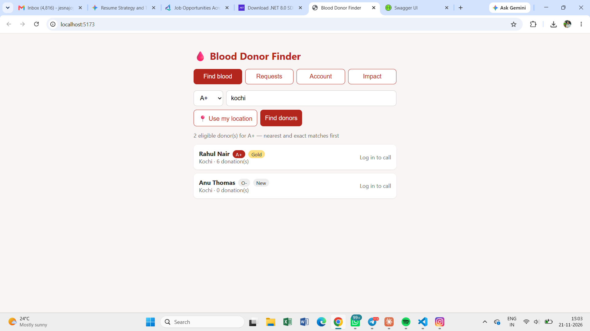
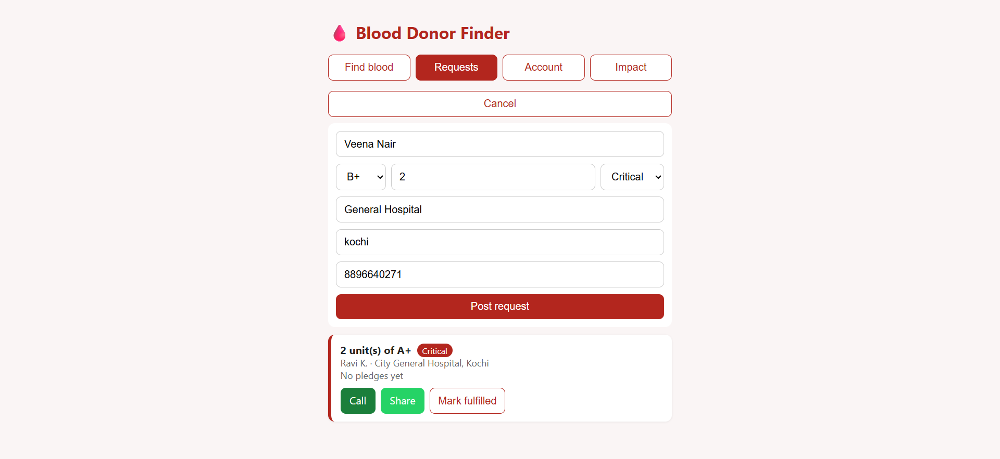
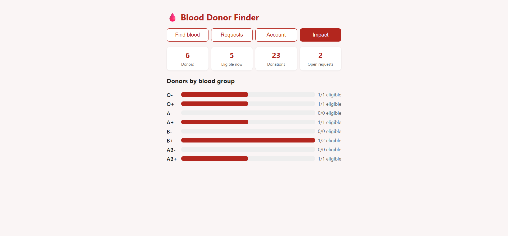

# 🩸 Blood Donor Finder

**A full-stack platform that connects people who urgently need blood with nearby, compatible and eligible donors, in minutes instead of hours.**

Built with **ASP.NET Core 8**, **React**, **EF Core + SQLite** and **JWT authentication**.


---

## The problem

When a patient needs blood urgently, families often rely on forwarded WhatsApp messages and phone calls to find a donor. Many of the people who respond have the wrong blood type, donated recently, or live too far away. Time is lost on people who can't actually help.

## The solution

Blood Donor Finder filters donors **before** anyone makes a call. It only shows people who:

1. have a **compatible blood group** for the patient,
2. are **medically eligible** (a 90-day gap since their last donation),
3. are **available** and **close by**, ranked by distance.

New emergency requests also trigger **SMS alerts** to matching donors in the same city.

---

## Screenshots

| Find blood | Emergency requests | Impact dashboard |
|---|---|---|
|  |  |  |

---

## Features

**Smart donor search**
- Blood-group compatibility rules (for example, an AB+ patient can receive from all groups, and an O- patient only from O-)
- 90-day donation cool-down enforced automatically
- Distance-based matching using the Haversine formula, with a "use my location" option and a 5–100 km radius
- Exact blood-group matches ranked first, then nearest

**Emergency requests board**
- Urgency levels (Critical, Urgent, Normal), shown in priority order
- Compatible, eligible donors can pledge to help
- One-tap WhatsApp sharing
- Only the person who posted a request can mark it fulfilled

**SMS alerts**
- A new request alerts eligible, compatible donors in the same city
- The requester is notified when someone pledges
- Donors can opt out at any time
- Works out of the box with a console logger; Twilio support is built in

**Donor accounts and gamification**
- Register and log in with phone and password
- Profile with donation count, next eligible date and levels (Bronze, Silver, Gold, Hero)
- Pause availability, turn SMS alerts off, or delete the account

**Impact dashboard**
- Total donors, donors eligible right now, total donations, open requests
- Donors by blood group
- **Shortage alerts** when open demand exceeds the compatible supply

**Security and privacy**
- JWT authentication with PBKDF2-SHA256 salted password hashing
- Rate limiting on search and on login/register to block scraping and brute force
- Anonymous visitors see **masked phone numbers**; contact details need an account
- Health and location details are never exposed in public results
- Password hashes never leave the server (DTO-based responses)

---

## Tech stack

| Layer | Technology |
|---|---|
| Backend | C#, .NET 8, ASP.NET Core Minimal APIs |
| Database | SQLite via Entity Framework Core |
| Auth | JWT bearer tokens, PBKDF2 password hashing |
| Frontend | React 18, Vite, plain CSS |
| API docs | Swagger / OpenAPI (with JWT "Authorize" support) |
| Testing | xUnit unit tests and integration tests (`WebApplicationFactory`) |
| Messaging | Pluggable SMS provider (console logger or Twilio) |

---

## Project structure

```
BloodDonorFinder/
├── api/                    # ASP.NET Core 8 Web API
│   ├── Program.cs          # Endpoints, auth, rate limiting, DI setup
│   ├── Models.cs           # Entities, DTOs, validation, blood rules, geo maths
│   ├── Data.cs             # EF Core DbContext and demo data seeder
│   ├── Security.cs         # Password hashing
│   ├── Alerts.cs           # SMS abstraction (Console + Twilio) and alert service
│   └── appsettings.json
├── frontend/               # React + Vite single-page app
│   └── src/                # Search, Requests, Account and Stats screens
├── tests/                  # xUnit unit + integration tests
└── docs/                   # Screenshots
```

---

## Getting started

### Prerequisites
- [.NET 8 SDK](https://dotnet.microsoft.com/download/dotnet/8.0)
- [Node.js 18+](https://nodejs.org)

### Run it

```bash
# 1. Start the API (http://localhost:5000, Swagger at /swagger)
dotnet run --project api

# 2. In a second terminal, start the frontend (http://localhost:5173)
cd frontend
npm install
npm run dev
```

The database is created and seeded with demo data on first run.

### Demo accounts

| Phone | Password | Blood group | City |
|---|---|---|---|
| `9876500001` | `demo1234` | O- | Kochi |
| `9876500002` | `demo1234` | A+ | Kochi |
| `9876500005` | `demo1234` | AB+ | Thrissur |

Accounts `9876500001` to `9876500006` all use the same password.

### Run the tests

```bash
dotnet test tests
```

---

## How matching works

A patient can safely receive blood from these donor groups:

| Patient | Compatible donors |
|---|---|
| O- | O- |
| O+ | O-, O+ |
| A- | O-, A- |
| A+ | O-, O+, A-, A+ |
| B- | O-, B- |
| B+ | O-, O+, B-, B+ |
| AB- | O-, A-, B-, AB- |
| AB+ | All groups |

Search then keeps only donors who are available and past the 90-day cool-down, calculates the distance for each donor with coordinates, and sorts by exact match first, then nearest.

---

## API overview

Interactive documentation is available at `http://localhost:5000/swagger`.

| Method | Endpoint | Auth | Description |
|---|---|---|---|
| POST | `/auth/register` | – | Create an account, returns a JWT |
| POST | `/auth/login` | – | Log in, returns a JWT |
| GET | `/me` | ✅ | Current donor profile |
| PATCH | `/me/donation` | ✅ | Record a donation (starts the 90-day cool-down) |
| PATCH | `/me/availability?available=` | ✅ | Pause or resume availability |
| PATCH | `/me/sms?enabled=` | ✅ | Turn SMS alerts on or off |
| DELETE | `/me` | ✅ | Delete the account |
| GET | `/search?bloodGroup=&city=` or `&lat=&lng=&radiusKm=` | – | Compatible, eligible donors (phones masked unless logged in) |
| GET | `/requests` | – | Open requests, most urgent first |
| POST | `/requests` | ✅ | Post a request and alert matching donors |
| POST | `/requests/{id}/pledge` | ✅ | Pledge to donate |
| PATCH | `/requests/{id}/fulfill` | ✅ | Close a request (owner only) |
| GET | `/stats` | – | Impact dashboard data |

---

## Configuration

Settings live in `api/appsettings.json` and can be overridden with environment variables.

**Real SMS with Twilio**

```
Sms__Provider=Twilio
Twilio__AccountSid=...
Twilio__AuthToken=...
Twilio__From=+1...
```

By default, messages are written to the API console instead of being sent.

**Before deploying**
- Set a strong `Jwt__Key` (the one in the repo is a development placeholder)
- Set `SeedDemoData` to `false`
- Serve over HTTPS and restrict the CORS origin
- Replace `EnsureCreated()` with EF Core migrations

---

## Roadmap

- [ ] Move from SQLite to PostgreSQL for production
- [ ] EF Core migrations
- [ ] Email or phone OTP verification at sign-up
- [ ] Hospital and blood-bank accounts with verified requests
- [ ] Push notifications
- [ ] Docker Compose setup and CI pipeline

---

## Author

**Jesna**
[LinkedIn](https://linkedin.com/in/jesnajoy) · [GitHub](https://github.com/jesnamariyamjoy)